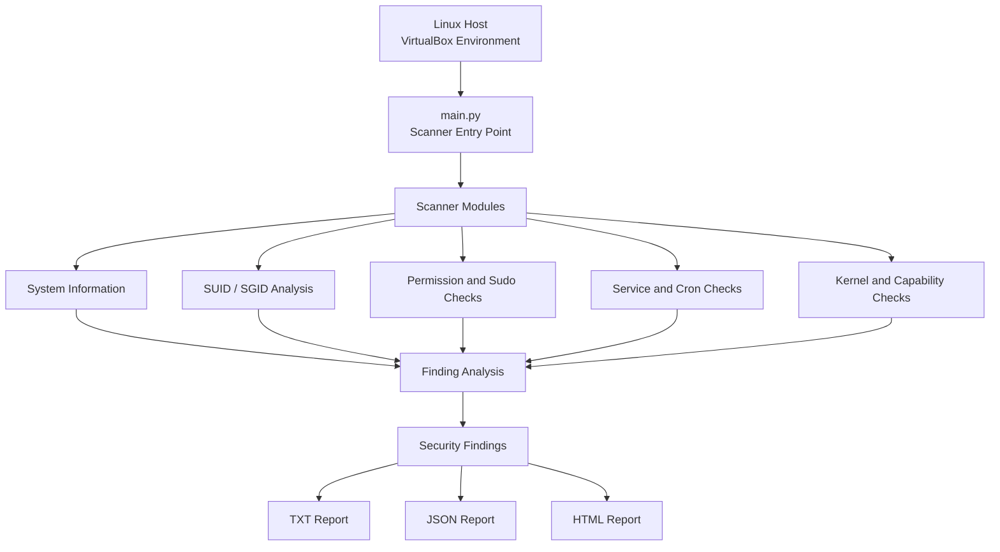
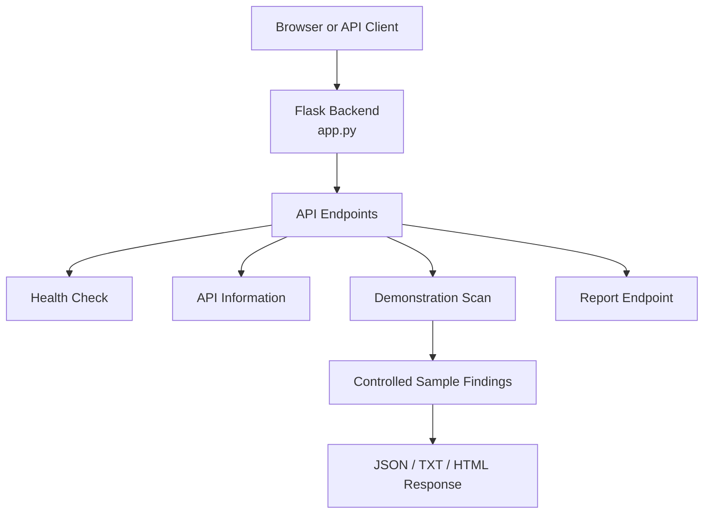

# 🛡️ Linux Privilege Escalation Detection Toolkit

### A Python-Based Linux Security Auditing Project

A modular, detection-only security toolkit designed to identify potential Linux privilege-escalation misconfigurations, analyze security evidence, and generate actionable audit reports.

**Developed by Omkar Raju Gurav**

[GitHub Repository](https://github.com/omkar2xt/linux-privesc-toolkit)

---

## 📌 Project Overview

Linux privilege escalation is a security concern that can arise when system permissions, privileged commands, scheduled tasks, services, or other configurations are improperly secured.

The **Linux Privilege Escalation Detection Toolkit** is a Python-based security auditing project that examines selected Linux configurations for conditions that may introduce privilege-escalation risks.

Instead of relying on a single check, the toolkit organizes security assessments into independent modules. The results are presented as structured findings containing evidence, severity classifications, and remediation recommendations.

The project also provides a Flask-based demonstration API that illustrates the application's reporting and API workflow without executing security scans on the deployed server.

> **Security principle:** Detect potential weaknesses, understand the evidence, and recommend corrective action — without executing privilege-escalation exploits.

## 🎯 Project Objectives

- Automate checks for common Linux privilege-escalation-related misconfigurations.
- Organize security checks into modular Python components.
- Provide evidence-based findings with severity classifications.
- Generate readable reports in TXT, JSON, and HTML formats.
- Support authorized local security assessments in a Linux environment.
- Demonstrate API functionality through a restricted, sample-data-based deployment.
- Maintain a detection-only design focused on security auditing and remediation guidance.

## ✨ Key Features

| Feature | Description |
|---|---|
| System Information | Collects user, UID, group, OS, kernel, and architecture information. |
| SUID/SGID Analysis | Examines files with special permission bits against configured detection rules. |
| Permission Auditing | Checks selected writable paths, sensitive file permissions, and home-directory permissions. |
| Sudo Rule Analysis | Identifies potentially risky sudo configurations, including selected `NOPASSWD` and unrestricted rules. |
| Service Configuration Checks | Examines selected root-run service configurations, writable executables, and insecure PATH entries. |
| Cron Job Analysis | Checks selected root cron jobs for references to writable scripts. |
| Kernel Reference Checks | Compares kernel versions with a local CVE reference list and basic end-of-life rules. |
| Linux Capabilities | Identifies selected potentially dangerous file capabilities using `getcap`. |
| Configurable Detection Rules | Uses JSON signatures for selected SUID/SGID, capability, and kernel checks. |
| Multi-Format Reports | Generates text, JSON, and HTML security reports. |
| Flask Demo API | Provides controlled demonstration findings and reporting endpoints. |

The findings represent potential security issues and require contextual verification. A detection result does not automatically establish that a system is exploitable.

## 🏗️ System Architecture

The project separates local security scanning from the deployed demonstration service.

### 1. Local Linux Scanner — Full Assessment

The local scanner is intended for an authorized Linux environment with access to the system being inspected.



**Workflow:**

1. The scanner starts through `main.py`.
2. Individual modules inspect their respective system configuration areas.
3. Detection rules identify conditions that may indicate a security weakness.
4. Findings are assembled with available evidence and recommendations.
5. Reports are generated for further inspection.

### 2. Deployed Demonstration API

The web application uses a separate execution path.



**Important:** In deployed demo mode, the application returns controlled demonstration data rather than executing host security scans or arbitrary system commands. A successful API response demonstrates the API workflow, not a real assessment of the deployed host.

## 📂 Repository Structure

The repository is organized into an application entry point, independent scanner modules, configuration, reporting utilities, and deployment support.

```text
linux-privesc-toolkit/
│
├── main.py
├── app.py
├── demo.sh
├── requirements.txt
├── render.yaml
├── README.md
│
├── config/
│   └── signatures.json
│
├── modules/
│   ├── __init__.py
│   ├── system_info.py
│   ├── suid_scan.py
│   ├── permission_scan.py
│   ├── sudo_scan.py
│   ├── service_scan.py
│   ├── cron_scan.py
│   ├── kernel_scan.py
│   ├── capability_scan.py
│   ├── report_html.py
│   └── config_loader.py
│
├── reports/
│   ├── report.txt
│   ├── report.json
│   └── report.html
│
└── screenshots/
    └── [Optional project screenshots]
```

*The report files shown above are the expected output paths; they may be generated at runtime rather than committed to the repository. The `screenshots/` directory is optional.*

### File and Directory Responsibilities

| File or directory | Purpose |
|---|---|
| `main.py` | Entry point for the full local security scanner. |
| `app.py` | Flask application and API entry point. |
| `demo.sh` | Script for launching the documented demonstration workflow. |
| `requirements.txt` | Python package dependencies for the backend. |
| `render.yaml` | Deployment configuration, if present and configured. |
| `config/signatures.json` | Configurable detection signatures for selected scanner modules. |
| `modules/system_info.py` | Collects basic system and user information. |
| `modules/suid_scan.py` | Examines SUID/SGID files. |
| `modules/permission_scan.py` | Checks selected file and directory permission conditions. |
| `modules/sudo_scan.py` | Examines selected sudo configuration risks. |
| `modules/service_scan.py` | Checks selected service unit, executable permission, and PATH conditions. |
| `modules/cron_scan.py` | Examines selected cron configurations and referenced writable scripts. |
| `modules/kernel_scan.py` | Compares kernel versions with local reference rules. |
| `modules/capability_scan.py` | Checks file capabilities using `getcap`. |
| `modules/report_html.py` | Generates formatted HTML reports. |
| `modules/config_loader.py` | Loads scanner configuration. |
| `modules/__init__.py` | Marks the modules directory as a Python package. |
| `reports/` | Destination for generated security reports. |
| `screenshots/` | Optional screenshots of the application and reports. |

## 🔍 Detection Modules

### System Information

Collects basic information about the current user and host, including user ID, groups, operating system, kernel version, and architecture.

### SUID/SGID Checks

Examines files with special permission bits and uses configured rules to identify files that may require additional security review.

### File Permission Checks

Examines selected world-writable files and directories, permissions associated with `/etc/passwd` and `/etc/shadow`, and home-directory permission conditions.

### Sudo Configuration Checks

Reviews selected sudo rules for potentially excessive privileges, including unrestricted permissions, `NOPASSWD` configurations, and commands that may provide shell access.

### Service Configuration Checks

Reviews selected systemd unit files for root-run services associated with writable executables and potentially insecure PATH entries.

The current implementation reads unit files directly; it does not necessarily query the active systemd manager.

### Cron Job Checks

Examines selected system-wide and per-user cron configurations for jobs that reference scripts with potentially unsafe write permissions.

### Kernel Version Checks

Compares detected kernel versions against a local reference list of CVEs and applies basic end-of-life checks.

The local reference list is limited and does not replace an up-to-date vulnerability assessment.

### Linux Capabilities

Uses `getcap` to inspect file capabilities and identify selected configurations that may warrant security review.

## 📊 Findings and Reporting

The toolkit is designed to present findings using a consistent structure.

| Field | Purpose |
|---|---|
| Title | Identifies the detected condition. |
| Evidence | Records details supporting the finding. |
| Severity | Indicates the configured priority classification. |
| Recommendation | Suggests an appropriate corrective action. |

### Severity classifications

- **INFO** — Informational observation.
- **LOW** — Lower-priority condition requiring review.
- **MEDIUM** — Condition warranting further investigation.
- **HIGH** — Potentially significant security concern.
- **CRITICAL** — Condition assigned the highest configured priority.

These classifications are intended for triage and are not a substitute for a validated risk assessment.

### Supported report formats

- **TXT:** Plain-text findings for quick review.
- **JSON:** Structured findings suitable for programmatic processing.
- **HTML:** Formatted findings for browser-based review.

The documented local report paths are:

```text
reports/report.txt
reports/report.json
reports/report.html
```

## ⚙️ Technology Stack

| Component | Technology |
|---|---|
| Programming language | Python |
| Operating system | Linux |
| Virtualization environment | Oracle VM VirtualBox |
| Backend framework | Flask |
| Production server | Gunicorn |
| Detection approach | Rule-based security checks |
| Detection configuration | JSON |
| Report formats | TXT, JSON, HTML |
| Deployment configuration | Render-compatible configuration |

## 💻 Development Environment

**Local development and security testing environment**

The local scanner is designed to run inside a Linux virtual machine hosted by Oracle VM VirtualBox.

```text
Physical Computer
       |
       v
Oracle VM VirtualBox
       |
       v
Linux Virtual Machine
       |
       v
Python Runtime
       |
       v
Linux Privilege Escalation Detection Toolkit
       |
       v
Security Findings and Reports
```

This isolated environment provides a controlled setting for examining Linux permissions, configurations, and detection behaviour.

The actual distribution used for testing should be recorded accurately. If Kali Linux was your testing environment, document it as Kali Linux running inside Oracle VM VirtualBox.

## 🚀 Installation and Usage

### Prerequisites

- A supported Linux distribution.
- Python 3.
- Appropriate permissions to inspect the intended system.
- `libcap2-bin` for capability checks that depend on `getcap`.

On Debian-based Linux distributions, install the optional capability utility:

```bash
sudo apt update
sudo apt install libcap2-bin
```

### Step 1: Clone the repository

```bash
git clone https://github.com/omkar2xt/linux-privesc-toolkit.git
cd linux-privesc-toolkit
```

### Step 2: Run the local scanner

```bash
python3 main.py
```

Review the generated reports in the `reports/` directory.

### Step 3: Run the demo script

```bash
./demo.sh
```

Inspect the script and follow its documented prerequisites if it cannot run as provided.

### Step 4: Start the Flask backend

Install the declared dependencies:

```bash
pip install -r requirements.txt
```

Launch the development server:

```bash
python app.py
```

The documented local API address is:

```text
http://localhost:5000
```

## 🌐 API Reference

The Flask backend documents the following endpoints.

| Method | Endpoint | Purpose |
|---|---|---|
| GET | `/health` | Returns health information. |
| GET | `/api/info` | Provides service and module information. |
| POST | `/api/scan` | Demonstrates the documented scan request workflow. |
| GET | `/api/report?format=json` | Retrieves a report in the requested format. |

### Example request

```bash
curl http://localhost:5000/health
```

Request a demonstration scan:

```bash
curl -X POST http://localhost:5000/api/scan \
  -H "Content-Type: application/json" \
  -d '{"type":"full"}'
```

Retrieve a report:

```bash
curl "http://localhost:5000/api/report?format=json"
```

**Demo limitation:** The deployed API uses controlled sample data. Do not describe its demonstration findings as results from scanning a real Linux host.

## 🧪 Testing and Verification

The project can be verified through a combination of API checks and controlled local test cases.

Recommended checks include:

1. Confirm the scanner starts successfully in the intended Linux environment.
2. Inspect the generated TXT, JSON, and HTML reports.
3. Verify individual detection rules against known, controlled configurations.
4. Check how the scanner handles insufficient permissions and missing optional utilities.
5. Confirm that API endpoints return the documented response formats.
6. Verify that deployed demo mode does not execute host commands.

The commands in this README describe how to exercise the application; they should not be interpreted as evidence that every module has passed a test.

## ⚠️ Limitations

- Kernel vulnerability references are based on a small local list rather than a live CVE feed.
- The service scanner reads unit files directly instead of querying a running systemd manager.
- Detection results depend on permissions, environment, and the available rules.
- No automatic remediation is performed.
- Deployed demo mode has intentionally limited functionality.
- Findings require contextual review before being treated as confirmed vulnerabilities.

## 🔮 Future Enhancements

Potential areas for future development include:

- Integration with a maintained vulnerability reference source such as the NVD.
- Automated regression tests for detection rules.
- Scan-to-scan report comparison.
- Improved evidence and remediation guidance.
- Multi-host auditing over authenticated SSH.
- Carefully controlled, confirmation-gated remediation capabilities.

These are proposed enhancements and should not be interpreted as existing features.

## 🔐 Security and Responsible Use

This toolkit is intended for authorized security assessments, educational use, and controlled environments.

- Scan only systems you own or have explicit permission to assess.
- Review evidence before concluding that a vulnerability exists.
- Use recommendations as a starting point for investigation and remediation.
- Do not treat demonstration data as evidence of a real security scan.
- Follow applicable laws and responsible disclosure practices.

The toolkit is designed to detect potential security misconfigurations. It does not execute privilege-escalation exploits or automatically modify system configurations.

## 📄 License

No license has been specified yet. All rights are reserved by default to the extent permitted by applicable law. Please contact the repository owner for permission before reusing, modifying, or redistributing the code.

## 👨‍💻 Author

**Omkar Raju Gurav**  
Computer Science and Engineering

GitHub: https://github.com/omkar2xt

---

*This project reflects practical work in Python programming, Linux security auditing, modular application design, and security report generation. Local scanner development and testing are associated with a Linux virtual machine running in Oracle VM VirtualBox.*
